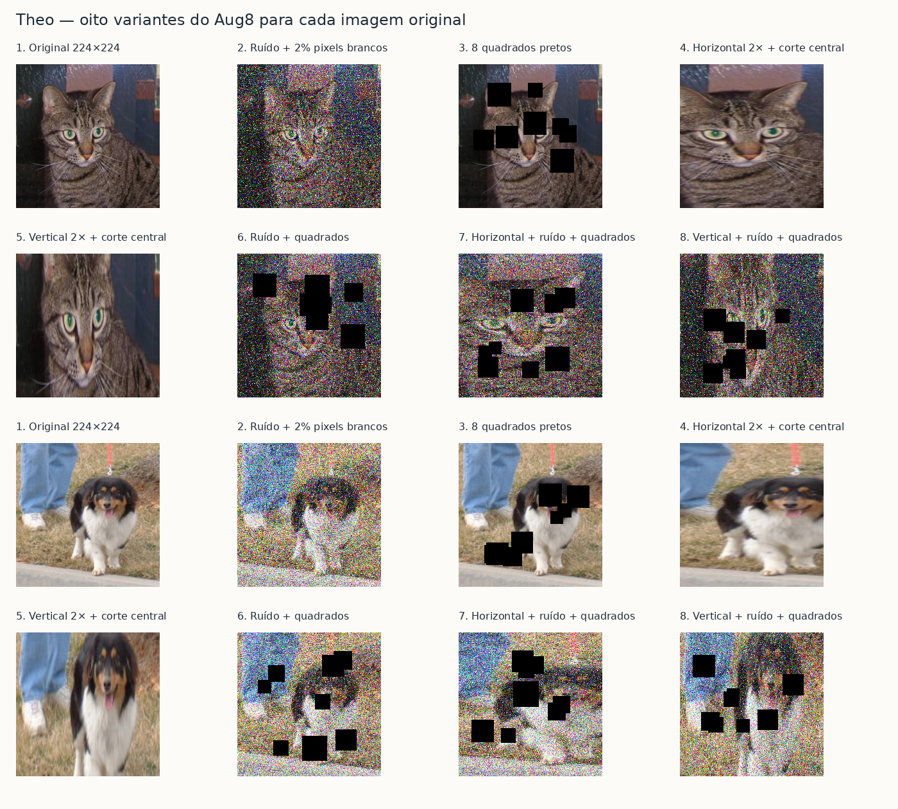

# Performance dos quatro modelos no banco Pets

## Como foi feita a comparação

Os quatro modelos receberam as mesmas 77 imagens:45 gatos e 32 cachorros.
Os rótulos de referência foram retirados das pastas Gatos e Cachorros do ZIP enviado;
não houve revisão manual independente desses rótulos. A classe positiva é Cão=1.
O limiar foi 0,5:probabilidade maior ou igual a 0,5 vira Cão;abaixo disso vira Gato.

Foram usados os checkpoints fechados e o pré-processamento de cada participante.
Nenhum modelo foi retreinado, calibrado ou selecionado com esses resultados.
Theo:Aug 8;Lisandra:AlexNet com BatchNorm;Dulce:CNN 224 v 2;
Bandeira:V 4 Final. Todos em eval(), com dropout desativado e inferência CUDA.
O Bandeira segue o fluxo publicado para imagem nova, com resize direto 384 × 384;
a diferença previamente documentada em relação à preparação offline do treino permanece.

## Como cada modelo foi treinado

Esta comparação usa os códigos e os parâmetros preservados dos modelos avaliados. As diferenças de treinamento ajudam a descrever os projetos, mas este teste não isola o efeito de cada técnica: arquitetura, dados e configurações mudaram ao mesmo tempo.

### Comparação dos hiperparâmetros

|Item|Theo — Aug8|Lisandra — AlexNetBinary|Dulce — CNN224 v2|Bandeira — V4 Final|
|---|---|---|---|---|
|Origem dos pesos|ResNet-34 ImageNet, seguida da repetição e do Aug8|Do zero|Do zero|V4 treinada do zero, seguida de fine-tuning|
|Otimizador final|AdamW|Adam|Adam|AdamW|
|Learning rate inicial da fase final|1e-5 na base; 5e-5 em layer3; 1e-4 em fc|1e-4|3e-4|1e-5|
|Weight decay|0,01|0|0|0,0001|
|Batch size|64|50|32|64|
|Duração registrada|30 épocas no Aug8, após a repetição|40 previstas; 10 executadas|120 épocas|30 na V4 + 10 no fine-tuning|
|Scheduler|CosineAnnealingLR: T_max=30; eta_min=1e-7|Sem scheduler|Sem scheduler identificado no treino final|CosineAnnealingLR: T_max=10; eta_min=1e-7 no fine-tuning|
|Dropout|10% fixo, entre Flatten e fc|50% em duas camadas da cabeça|20% após pooling de cada um dos cinco blocos|50% na cabeça|
|Congelamento na fase final|Nenhuma camada congelada|Nenhum|Nenhum|Parâmetros dos blocos 1–3 congelados; 4–5 e cabeça treináveis|
|Perda|BCEWithLogitsLoss|BCEWithLogitsLoss|Entropia cruzada: NLLLoss com LogSoftmax|BCEWithLogitsLoss|
|BatchNorm|Nos blocos da ResNet|Após cada convolução|Ausente nesta CNN|Após cada convolução|
|Escolha do peso final|Maior acurácia de validação|Menor perda de validação|Maior acurácia de validação|Menor perda de validação|
|Early stopping|Sem parada antecipada na fase Aug8 registrada|Paciência 5; acionado|Sem early stopping no loop final|Paciência 4 na fase final; completou as 10 épocas|
|Semente registrada|42|Sem semente manual no código publicado|18|42|

Adam e AdamW ajustam os passos do otimizador. O AdamW aplica weight decay de forma desacoplada; nos modelos com Adam, o decay registrado é zero. Dropout desativa aleatoriamente parte das ativações durante o treino; fica desligado na avaliação. BatchNorm normaliza ativações dentro da rede e é diferente da normalização dos pixels de entrada. O scheduler por cosseno reduz o learning rate ao longo da fase de treinamento. Não há warmup no Aug8 nem no fine-tuning final do Bandeira.

### Theo: transferência de aprendizado e Aug8

O Theo usa uma ResNet-34 com layer4 removida. Os estágios restantes têm canais 64/128/256 e conexões residuais, seguidos de média global e uma saída. A linhagem dos pesos passa pela repetição baseada em ImageNet e depois diretamente pelo Aug8. A referência histórica é metodológica; não fornece pesos à repetição.

Na repetição, foi usado Adam com LR 0,001, batch 64, 16 ampliações históricas e sem dropout efetivo; o backbone ficou congelado nas primeiras cinco épocas completas. No Aug8, todos os parâmetros ficam treináveis, com AdamW novo e três grupos: conv1/bn1/layer1/layer2 com LR 1e-5; layer3 com 5e-5; fc com 1e-4. As taxas decaem por cosseno até 1e-7. O dropout permanece fixo em 10%; a opção de dropout crescente não estava ativa nessa execução. Os argumentos efetivos registram betas=(0,9;0,999), eps=1e-8 e weight decay=0,01. O treinamento Aug8 utilizou precisão mista.

A divisão de originais é feita antes das variantes: 19.998 imagens de treino e 5.000 de validação. As oito versões por original produzem 159.984 amostras virtuais por época. Ruídos e quadrados são sorteados na leitura; as variantes não constituem 159.984 novas fotografias independentes. A validação não recebe essas perturbações.

### Amostra das ampliações do Theo

A imagem foi gerada pelo próprio DatasetManifesto do Aug8, usando os parâmetros salvos dessa execução e duas fotos do banco original. É uma ilustração reproduzível do método, não uma captura dos lotes históricos nem uma alteração nas fotos do teste Pets.

1. Original redimensionada diretamente para 224×224.
2. Ruído gaussiano de média zero e variância 0,08 na escala [0,1], com corte dos valores para esse intervalo, mais 2% dos pixels brancos.
3. Oito quadrados pretos, lados entre 20 e 40 pixels; centros sorteados na região central de 150×150. Os quadrados podem se sobrepor.
4. Esticamento horizontal 2× e recorte central de 224×224.
5. Esticamento vertical 2× e recorte central de 224×224.
6. Ruído e quadrados.
7. Esticamento horizontal, ruído e quadrados.
8. Esticamento vertical, ruído e quadrados.

O tensor é normalizado pelas médias/desvios do ImageNet. Para visualizar o sampling, essa normalização foi desfeita. A geometria histórica de avaliação preserva proporção: menor lado 256 e recorte central 224, diferente do resize direto usado como base das ampliações de treino.

### Lisandra: treino do zero com BatchNorm e dropout na cabeça

A AlexNetBinary possui cinco convoluções, canais 96/256/384/384/256 e uma cabeça densa 4096→4096→1. Usa Adam com LR fixo 1e-4, betas=(0,9;0,999), eps=1e-8 e weight decay zero. O batch é 50 e a perda é BCEWithLogitsLoss. A regularização inclui BatchNorm após as convoluções, dois dropouts de 50% na cabeça e early stopping por perda de validação com paciência 5.

Não há pesos pré-treinados, congelamento ou scheduler. O pacote não declara augmentation. As imagens passam por resize direto para 224×224 e Normalize ImageNet. Essa normalização não significa que os pesos foram treinados no ImageNet. A divisão registrada é 19.998 treino, 2.500 validação e 2.500 teste.

### Dulce: CNN do zero com augmentation fixo e online

A CNN224 v2 tem cinco blocos Conv5×5→ReLU→MaxPool→Dropout20%, canais 32/64/64/128/128, seguidos de cabeça 1024→32→2. Foi treinada com Adam, LR fixo 3e-4, batch 32, 120 épocas e seed 18. A perda é entropia cruzada, implementada com LogSoftmax e NLLLoss. O loop final não contém scheduler ou early stopping, e não usa BatchNorm ou pesos pré-treinados. O Adam não especifica decay adicional; usa weight decay zero.

Há filtragem de duplicatas e quase duplicatas, divisão por grupos de origem e descarte de imagens com lado menor que 94 pixels. O split registrado contém 17.934 originais de treino, 3.165 de validação e 3.723 de teste. As cópias fixas aumentam o treino para 21.520 amostras: 10% com rotação de 15° e 10% com ruído gaussiano de desvio 2 na escala 0–255. Nos lotes, também há espelhamento, zoom 0,7–1, deslocamento, rotação ±15° e brilho/contraste 0,8–1,2.

O resize bilinear preserva a proporção com recorte central 224×224. Os pixels ficam em [0,1], sem Normalize ImageNet. Validação e teste usam originais, sem augmentation de treino. A variância 0,08 do Theo e o desvio 2 do ruído da Dulce usam escalas diferentes e não devem ser lidos como intensidades equivalentes.

### Bandeira: CNN V4 do zero e fine-tuning parcial

A CNN V4 tem cinco blocos Conv3×3→BatchNorm→ReLU→MaxPool, canais 32/64/128/256/512, média global e uma saída. Na fase inicial, usa AdamW com LR 0,001, weight decay 0,0001, batch 64, cosseno T_max=30 até 1e-6 e early stopping de paciência 7. O treino inicial usa RandomResizedCrop384(scale 0,8–1), flip horizontal, rotação ±15° e jitter de brilho/contraste 0,2.

A fase Final carrega o peso da V4 e cria novo AdamW com LR 1e-5, mesmo decay e batch, cosseno T_max=10 até 1e-7 e early stopping de paciência 4. A perda continua BCEWithLogitsLoss e o dropout da cabeça continua em 50%. Os parâmetros dos três primeiros blocos ficam congelados; os dois últimos e o classificador aprendem. Como o código chama model.train(), as estatísticas correntes das BatchNorm nos blocos congelados continuam sendo atualizadas: isso não é congelamento completo de todos os seus estados.

O augmentation final é mais suave: RandomResizedCrop384(scale 0,9–1), flip horizontal com probabilidade 0,5, rotação ±5° e jitter de brilho/contraste 0,05. O split é estratificado 80/20, seed 42, com 20.000 treino e 5.000 validação esperados. A normalização usa estatísticas do próprio treino. Na inferência Pets, seguimos o fluxo do autor para imagem nova: resize direto para 384×384. A preparação offline anterior com proporção e corte central é uma diferença já registrada a confirmar com o autor.

### Principais diferenças entre os projetos

- **Origem e arquitetura:** Theo parte de ImageNet e usa resíduos; Lisandra e Dulce treinam suas CNNs do zero; Bandeira treina a V4 do zero e depois faz um ajuste parcial da própria rede.
- **Otimização:** Theo e Bandeira usam AdamW e cosseno na fase final; Lisandra e Dulce usam Adam com taxa fixa. Só Theo divide os módulos em grupos com taxas diferentes nessa fase.
- **Regularização:** Theo usa dropout de 10% somente antes da saída; Lisandra usa dois dropouts de 50% na cabeça; Dulce usa 20% em cada bloco; Bandeira usa 50% na cabeça. A posição e a quantidade de camadas são diferentes, portanto as porcentagens isoladas não medem a regularização total.
- **Dados:** Theo Aug8 enfatiza ruído, ocultação com quadrados e deformações; Dulce combina cópias fixas e augmentation online; Bandeira usa transformações online e reduz sua intensidade no ajuste final; Lisandra não declara augmentation no pacote publicado.
- **Escala e divisão:** Bandeira trabalha em 384×384, os demais em 224×224. Os splits, o tratamento de duplicatas e as normalizações também diferem. As validações não são um banco único compartilhado.
- **Seleção:** Theo e Dulce escolhem por acurácia de validação; Lisandra e Bandeira por perda de validação. O ranking Pets foi calculado separadamente, usando a mesma base para todos, sem mudar esses critérios anteriores.

### Fontes dos métodos

As informações foram conferidas nos arquivos locais preservados: Theo/modelo principal/treinamento_aug8/parametros.json e ampliacao8.py; Lisandra/modelo principal/parametros.json e METODO.md; Dulce/modelo principal/METODO.md e notebook cats_and_dogs_224_v2.ipynb; Bandeira/modelo principal/parametros.json, parametros_v4_base.json e src/fine_tuning.py. O sampling usa a configuração salva do Aug8 e duas imagens ilustrativas do banco de treinamento.

## Ranking

Critério:maior acurácia no conjunto completo. Empates mantêm a mesma posição.
Precisão, recall e F 1 abaixo são da classe Cão. Também mostramos acurácia
balanceada, que dá o mesmo peso ao acerto em gatos e em cães.

|Posição|Modelo|Acertos|Acurácia|Precisão Cão|Recall Cão|F 1 Cão|Acurácia balanceada|
|---|---|---|---|---|---|---|---|
|1|Theo|66/77|85,71%|75,61%|96,88%|84,93%|87,33%|
|2|Bandeira|61/77|79,22%|69,05%|90,62%|78,38%|80,87%|
|3|Dulce|59/77|76,62%|65,91%|90,62%|76,32%|78,65%|
|4|Lisandra|48/77|62,34%|53,49%|71,88%|61,33%|63,72%|

## Resultado de cada participante

### Theo

Acertou 66 das 77 imagens (85,71%) e errou 11. Entre os 45 gatos, acertou 35 e classificou 10 como cães. Entre os 32 cães, acertou 31 e classificou 1 como gatos. O F 1 da classe Cão foi 84,93%.

### Bandeira

Acertou 61 das 77 imagens (79,22%) e errou 16. Entre os 45 gatos, acertou 32 e classificou 13 como cães. Entre os 32 cães, acertou 29 e classificou 3 como gatos. O F 1 da classe Cão foi 78,38%.

### Dulce

Acertou 59 das 77 imagens (76,62%) e errou 18. Entre os 45 gatos, acertou 30 e classificou 15 como cães. Entre os 32 cães, acertou 29 e classificou 3 como gatos. O F 1 da classe Cão foi 76,32%.

### Lisandra

Acertou 48 das 77 imagens (62,34%) e errou 29. Entre os 45 gatos, acertou 25 e classificou 20 como cães. Entre os 32 cães, acertou 23 e classificou 9 como gatos. O F 1 da classe Cão foi 61,33%.

## Validação do treinamento × nosso banco Pets

Os números de validação correspondem aos modelos usados nesta avaliação. Cada participante possui seu próprio conjunto de validação.

|Modelo|Validação|Pets|Pets − validação|
|---|---|---|---|
|Theo|98,32%|85,71%|-12,61 p.p.|
|Bandeira|94,76%|79,22%|-15,54 p.p.|
|Dulce|96,90%|76,62%|-20,28 p.p.|
|Lisandra|90,16%|62,34%|-27,82 p.p.|

Todos tiveram acurácia menor no banco Pets que na sua validação. A diferença é observada entre conjuntos distintos e não identifica, sozinha, sua causa. As 77 fotos não têm o mesmo tamanho, composição e distribuição dos conjuntos originais. Não foi feita alteração nos modelos a partir deste teste.

[Gráfico de comparação](validacao_vs_pets.svg) · [Tabela completa e fontes](validacao_vs_pets.csv). A tabela também preserva acurácia de treino e perda de validação do modelo avaliado; acurácia de treino é a registrada durante o treino, com as ampliações e regularizações de cada modelo.

## Leitura dos resultados

Neste conjunto, Theo ficou na primeira posição por acurácia, com 66 acertos. Cada imagem equivale a aproximadamente 1,30 ponto percentual de acurácia. As diferenças descrevem este banco pequeno e não demonstram, sozinhas, superioridade geral. O conjunto contém mais gatos que cães; por isso o relatório separa os erros por classe e inclui acurácia balanceada.

A unanimidade foi 44/77 e houve divergência em 33 imagens. Concordância entre modelos não é uma medida de acerto. As probabilidades são as saídas contínuas dos modelos, sem calibração adicional.

## Arquivos

- [Ranking visual](ranking.svg).
- [Matrizes de confusão](matrizes_confusao.svg).
- [CSV do ranking](ranking.csv).

## Publicação

Esta cópia reúne o relatório e resultados agregados. Fotos pessoais, nomes de imagens, predições individuais, ZIP recebido e checkpoints permanecem locais na avaliação completa.
